# LazyCopper

A clean personal blog and profile theme for [Hugo](https://gohugo.io), styled with [Tailwind CSS v4](https://tailwindcss.com).

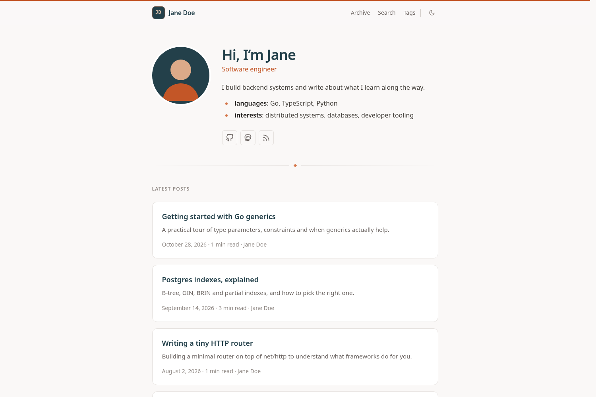

## Features

- Home page with a profile intro, social links and paginated posts
- Light and dark mode, following the system setting by default, with a toggle
- Client-side search with no external service
- Archive grouped by year, tag pages, breadcrumbs and previous/next post links
- Narrow or wide layout; the wide one shows the table of contents in a sticky sidebar that highlights the current section
- Reading progress bar under the navigation on posts
- Heading anchors and copy buttons on code blocks
- Open Graph, Twitter cards, JSON-LD and Google Analytics 4
- No JavaScript framework and no web fonts: the CSS is built from the classes your site actually uses

## Screenshots

### Narrow layout (default)

| Light | Dark |
| --- | --- |
| 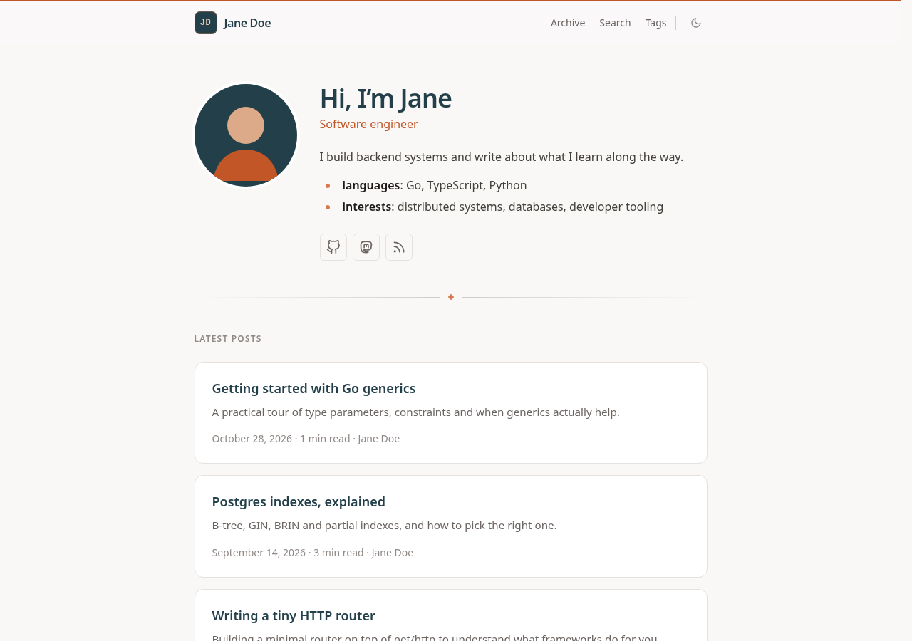 | 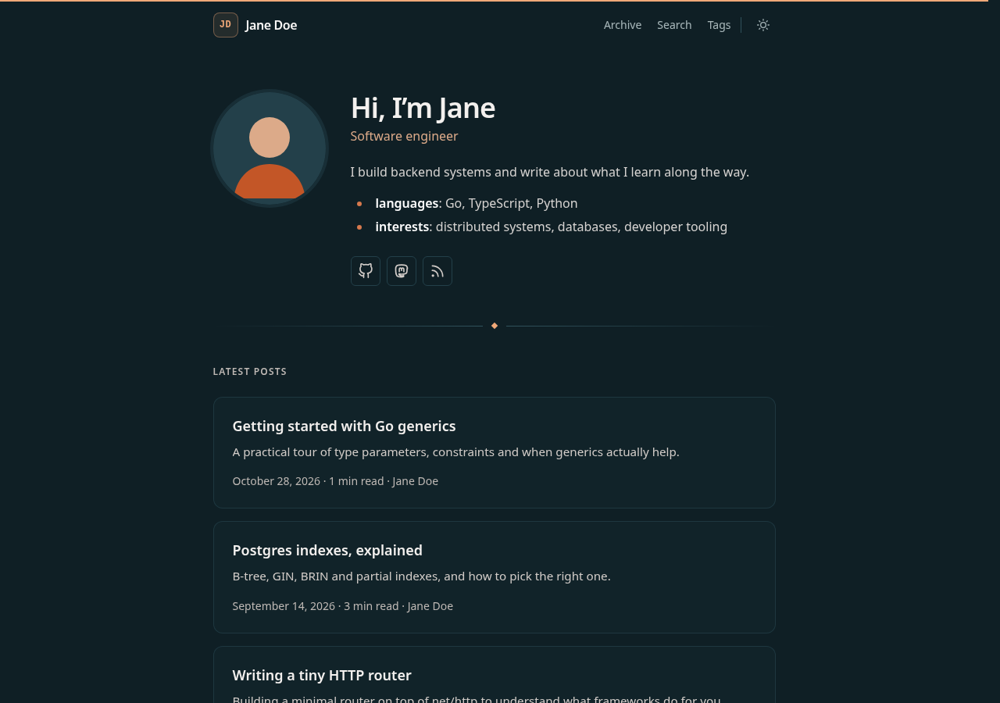 |
| 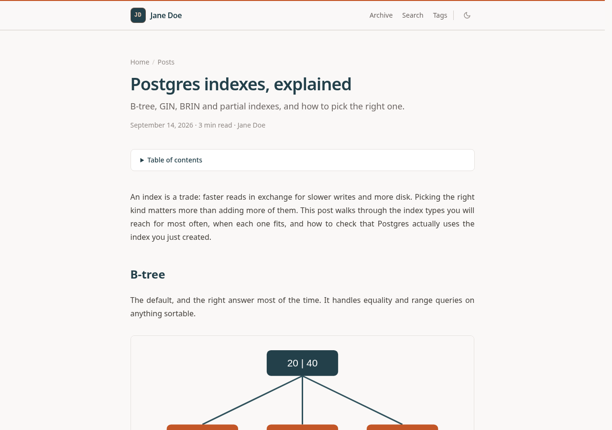 | 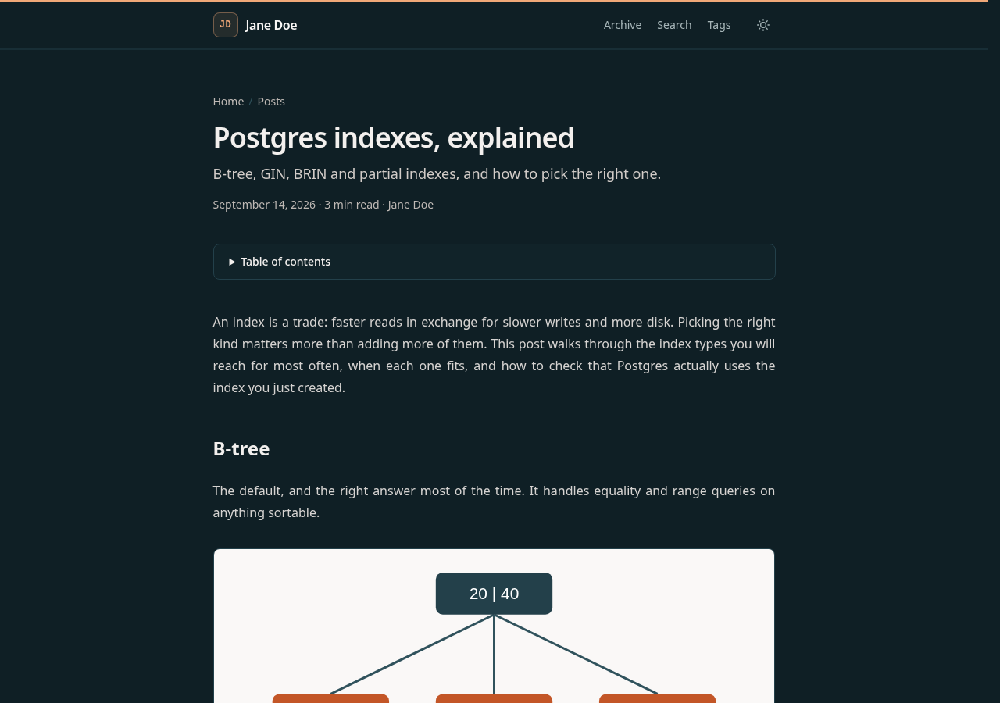 |

### Wide layout (`width = "wide"`)

| Light | Dark |
| --- | --- |
| 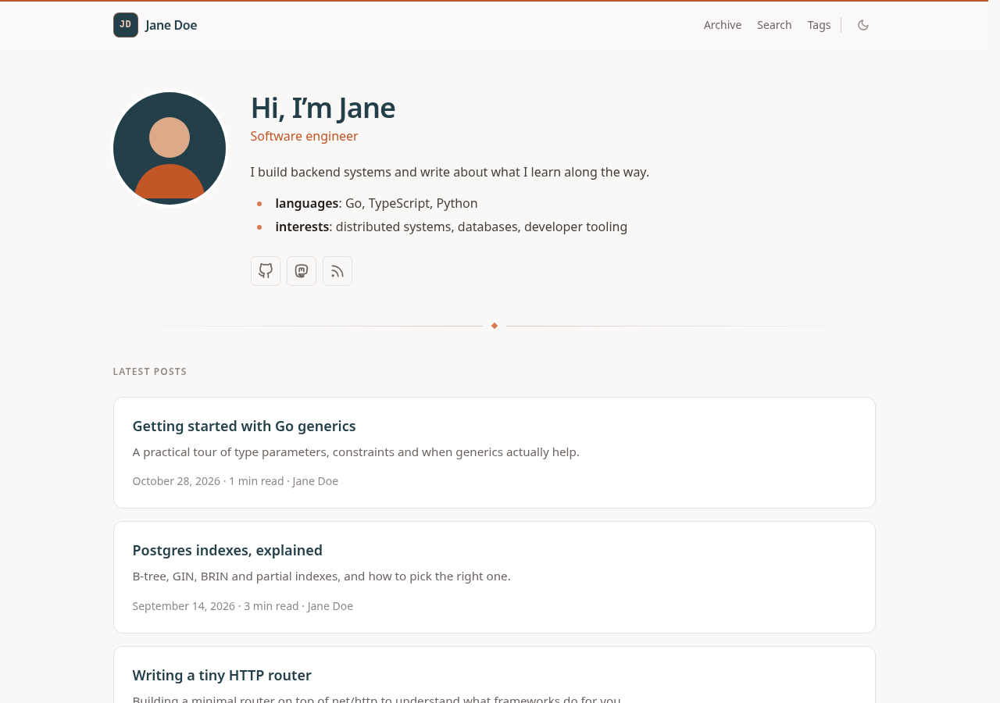 | 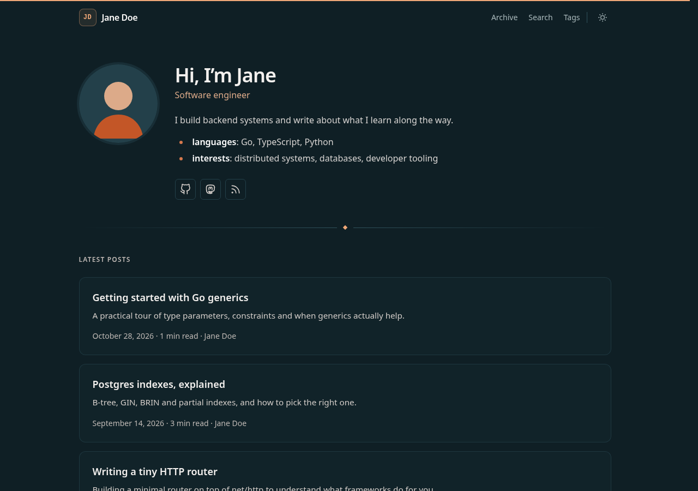 |
| 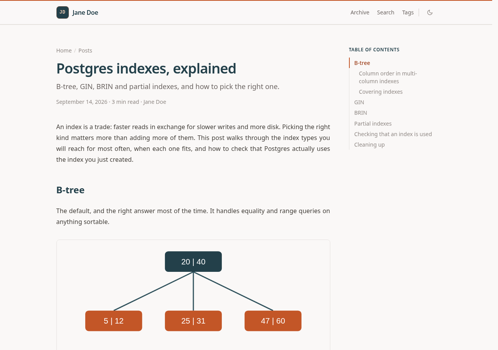 | 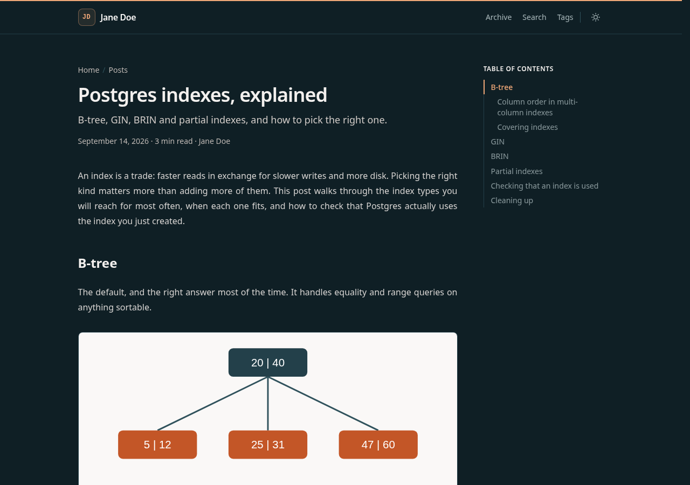 |

### Archive, search and mobile

| Archive | Search |
| --- | --- |
| 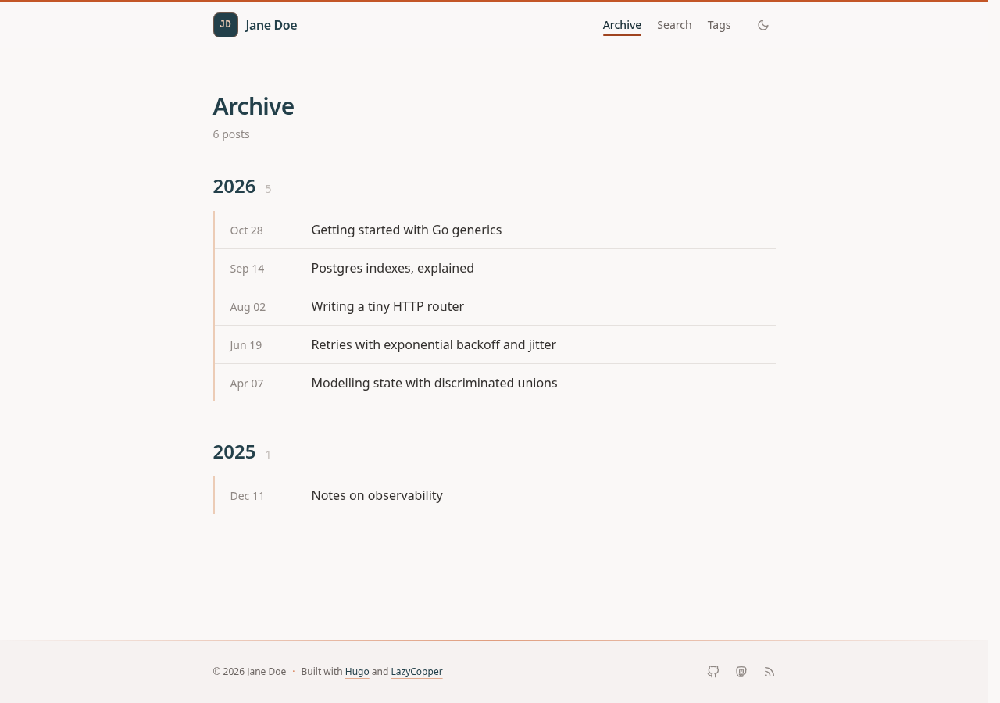 | 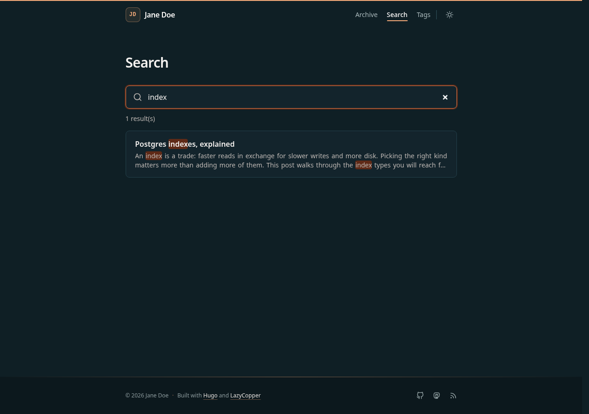 |

<p align="center">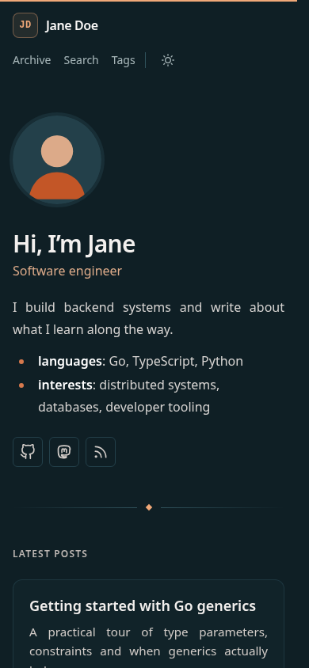</p>

## Requirements

- [Hugo](https://gohugo.io/installation/) 0.158 or newer
- [Node.js](https://nodejs.org) 20 or newer, which Hugo uses to run Tailwind

## Quick start

These steps assume you already have a Hugo site. For a new one, run `hugo new site my-blog && cd my-blog && git init` first.

**1. Add the theme:**

```sh
git submodule add https://github.com/replsv/hugo-lazycopper.git themes/lazycopper
```

**2. Install Tailwind** in your site's root folder (the one with `hugo.toml`):

```sh
npm install -D tailwindcss @tailwindcss/cli @tailwindcss/typography
```

**3. Configure your site.** Replace the contents of `hugo.toml` with this, then change the values to your own:

```toml
baseURL = "https://example.org/"
locale = "en-us"
title = "Jane Doe"
theme = "lazycopper"

# Search needs the JSON output on the home page
[outputs]
  home = ["HTML", "RSS", "JSON"]

[params]
  author = "Jane Doe"
  description = "Notes on software and side projects."

  [params.homeInfoParams]
    Title = "Hi, I'm Jane"
    Subtitle = "Software engineer"
    ProfilePic = "avatar.jpg" # a file in static/
    Content = "I build things and write about what I learn."

  [[params.socialIcons]]
    name = "github"
    url = "https://github.com/janedoe"

[[menus.main]]
  name = "Archive"
  url = "archive/"
  weight = 10
[[menus.main]]
  name = "Search"
  url = "search/"
  weight = 20
[[menus.main]]
  name = "Tags"
  url = "tags/"
  weight = 30

# Everything below is needed for Tailwind. Copy it as is.
[security.exec]
  allow = ['^(dart-)?sass$', '^go$', '^git$', '^node$', '^postcss$', '^tailwindcss$']

[build.buildStats]
  enable = true

[[build.cachebusters]]
  source = 'assets/notwatching/hugo_stats\.json'
  target = 'css'

[[module.mounts]]
  source = 'assets'
  target = 'assets'

[[module.mounts]]
  source = 'hugo_stats.json'
  target = 'assets/notwatching/hugo_stats.json'
  disableWatch = true
```

**4. Add the archive and search pages:**

```sh
printf -- '---\ntitle: Archive\nlayout: archives\n---\n' > content/archive.md
printf -- '---\ntitle: Search\nlayout: search\n---\n' > content/search.md
```

**5. Write a post and start the server:**

```sh
hugo new content posts/hello-world.md
hugo server --buildDrafts
```

Open <http://localhost:1313>. New posts are drafts until you set `draft: false` in their front matter.

To try the theme with sample content first, run `npm install && hugo server` inside [`exampleSite`](exampleSite).

## Configuration

All of these go under `[params]` in `hugo.toml`, and all are optional.

| Setting | Default | What it does |
| --- | --- | --- |
| `author` | | Your name, shown on posts and used in metadata |
| `description` | | Site description for search engines and social previews |
| `keywords` | | Keywords for the home page, e.g. `["blog", "go"]` |
| `images` | | Default image for social previews, e.g. `["cover.png"]` |
| `env` | | Set to `"production"` to let search engines index the site |
| `defaultTheme` | `"auto"` | `"auto"`, `"light"` or `"dark"` |
| `disableThemeToggle` | `false` | Hide the light/dark toggle |
| `disableScrollToTop` | `false` | Hide the "back to top" button |
| `mainSections` | your largest section | Sections listed on the home page, archive and search, e.g. `["posts"]` |
| `hideSummary` | `false` | Show only titles in post lists |
| `DateFormat` | `":date_long"` | Any [Hugo date format](https://gohugo.io/functions/time/format/) |
| `ShowReadingTime` | `false` | Show the estimated reading time |
| `ShowAuthor` | `true` | Show the author name on posts |
| `ShowBreadCrumbs` | `true` | Show breadcrumbs above titles |
| `ShowPostNavLinks` | `true` | Show links to the previous and next post |
| `ShowCodeCopyButtons` | `true` | Add a copy button to code blocks |
| `width` | `"narrow"` | `"narrow"` for a single reading column, `"wide"` for a wider page with the table of contents in a sidebar next to posts |
| `ShowToc` | `false` | Show a table of contents on posts longer than 400 words: a sidebar on large screens with the wide layout, a collapsible block otherwise |
| `TocOpen` | `false` | Expand the collapsible table of contents by default |
| `comments` | `false` | Show comments under posts (see [Customizing](#customizing)) |
| `label.text` | site title | Text next to the logo in the header |
| `label.monogram` | initials | Letters in the logo badge |
| `footer.text` | | Markdown shown after the copyright line |
| `footer.note` | | Smaller line of markdown under the footer text |

The copyright line uses the site's `copyright` setting, or `© <year> <title>` if it isn't set.

### Profile

`[params.homeInfoParams]` controls the intro on the home page. Leave it out to skip the intro.

| Setting | What it does |
| --- | --- |
| `Title` | Heading |
| `Subtitle` | Line under the heading |
| `ProfilePic` | Path or URL of your photo |
| `Content` | Markdown text; lists work well here |

### Social icons

Each `[[params.socialIcons]]` entry takes a `name`, a `url` and an optional `title` for the tooltip.
The icons appear on the profile and in the footer.

Available names: `github`, `gitlab`, `linkedin`, `x`, `twitter`, `mastodon`, `bluesky`, `stackoverflow`,
`youtube`, `instagram`, `facebook`, `email`, `rss`, `website`. For email, use `mailto:you@example.org` as the URL.

### Favicons

Put `favicon.ico`, `favicon-16x16.png`, `favicon-32x32.png` and `apple-touch-icon.png` in your `static/` folder.
To use other paths, set `favicon`, `favicon16x16`, `favicon32x32` and `apple_touch_icon` under `[params.assets]`.

### Analytics and site verification

```toml
[services.googleAnalytics]
  id = "G-XXXXXXXXXX"

[privacy.googleAnalytics]
  respectDoNotTrack = true

[params.analytics.google]
  SiteVerificationTag = "..."
[params.analytics.bing]
  SiteVerificationTag = "..."
```

Analytics is only added to production builds (`hugo`, not `hugo server`).

### Post front matter

```yaml
---
title: "My post"
date: 2026-01-31
description: "Shown under the title and in post lists"
tags: [go, databases]
cover:
  image: "images/cover.png"
  alt: "Cover image"
  caption: "Optional caption"
width: wide             # override the site layout width for this page
ShowToc: true           # override the site setting for this post
TocOpen: true
hideMeta: true          # hide the date, reading time and author
hiddenInHomeList: true  # keep the post off the home page
searchHidden: true      # keep the post out of search
disableBreadcrumbs: true
comments: true
---
```

## Customizing

To change a template, copy it from `themes/lazycopper/layouts/` to the same path under your site's `layouts/` folder and edit the copy.
Hugo uses your version instead of the theme's.

Three templates are left empty for this purpose:

- `layouts/_partials/extend_head.html` is added at the end of `<head>`
- `layouts/_partials/extend_footer.html` is added at the end of `<body>`
- `layouts/_partials/comments.html` is shown under posts when `comments` is on; put your Giscus, Disqus or other embed code here

To change the colors, copy `themes/lazycopper/assets/css/main.css` to `assets/css/main.css` in your site and edit the
`--color-copper-*`, `--color-teal-*` and `--color-stone-*` values.

## Updating

```sh
git submodule update --remote themes/lazycopper
```

## License

[MIT](LICENSE)
